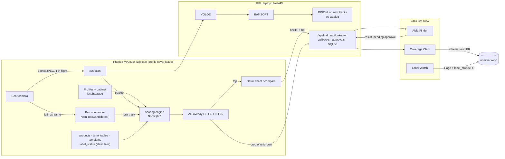

# Nomifier: final plan

**Nomify everything in view, live.**
Nomifier builds on BDBI's **Nomi**, the over-the-counter (OTC) medicine safety scanner.

- **Point your phone at medicine.** Hold up a box or a bottle, or sweep across a shelf. Every product gets a **green, orange or red AR outline** in real time, scored for the person who'll take it. Outlines stick to the products as they move.
- **Tap any product** for Nomi's cited breakdown, a safer pick, duplicate-ingredient warnings against your medicine cabinet, and more.
- **A Grok Bot crew** finds the safer option in stock nearby, grows Nomi's product data through reviewed pull requests, and watches for label changes and recalls.
- **The user's health data never leaves their phone.**

_Built for the BDBI x SpaceXSI Grokathon (Georgia Tech, Nov 2 2026, judged on creative use of Cursor and Grok Bot). The event requires building on a current BDBI project. Implementation split: `Nomifier - 3-person implementation plan.md`._

---

## 1. The project we're building on

**[Nomi](https://github.com/gt-big-data/nomi)** (BDBI, started Sep 2026, leads Shreyas Shrestha and Utkarsh Bagaria) is "Yuka for medicine": scan one OTC box's barcode and get a personalized 0–100 safety score, the cited reasons, and a safer option.

**Nomi's design rules, which we keep:**

1. **Health data never leaves the phone.** Scoring runs on the device from lookup tables.
2. **Every number is explainable and cited.** LLMs **never produce scores**.
3. **The knowledge base is reviewed through pull requests.**

**What exists in Nomi today (read at commit `aa8d723`), and what we reuse:**

| Reuse as-is                                                                            | Where in Nomi                                                                                  |
| -------------------------------------------------------------------------------------- | ---------------------------------------------------------------------------------------------- |
| JSON Schemas (`product`, `term-tables`, `score-record`, `common`, …)                   | `packages/schema/schemas/`                                                                     |
| Generated TypeScript types for all of them                                             | `packages/schema/generated/ts/`                                                                |
| Python package `nomi-schema` with `validate(schema, data)`                             | `packages/schema`                                                                              |
| Barcode → 3 NDC11 candidates, in TS and Python, with shared fixtures                   | `apps/mobile/src/lib/barcode.ts`, `pipeline/.../identity/barcode.py`, `fixtures/barcodes.json` |
| 15 risk dimensions, 8 personas, conditions, medication types, severity → points bands  | `docs/scoring/dimensions.md`, `common.schema.json`                                             |
| The scoring function (additive terms, `max_plus_stacking`, hard stops, tiers 75 / 50)  | `docs/system-design.md` §6.2                                                                   |
| Result-card design: Verdict + larger number, plain-language risk list, visible sources | `docs/design/score-visualization.md`                                                           |

**What Nomi doesn't have yet, which we build (and can offer back as PRs):** term-table data (NOMI-034/035), the on-device scoring engine (NOMI-060), barcode → product resolution (slice of NOMI-025), explanation templates (NOMI-048), alternatives (NOMI-055) and the Medicine Cabinet (post-demo in Nomi's roadmap). Nomi's Expo app is not built yet (only `barcode.ts` exists) and its pipeline stages are stubs.

**The gap Nomifier fills:** Nomi scans one barcode at a time. Real decisions happen in front of a shelf, a cabinet or a bag of pill bottles, with look-alike products everywhere.

---

## 2. The app: live AR medicine scanner

An installable **PWA that looks and behaves like a native iPhone app**, served by our GPU laptop over **Tailscale** HTTPS, and talking to the recognition server on that same laptop.

### The iPhone-app shell (PWA)

- **Installs to the iPhone home screen** (Safari → Share → Add to Home Screen) and opens full screen with no browser bars: web app manifest with `display: "standalone"`, an app icon (`apple-touch-icon`), theme color, and `viewport-fit=cover`.
- **Feels native:** iOS system font (`-apple-system`), a bottom **tab bar** (Scan · Cabinet · Profiles · History), **bottom sheets** with a grabber for details, large-title headers, and layouts that respect the notch and home indicator (`env(safe-area-inset-*)`). Light and dark mode follow the phone.
- **Works offline except for vision:** a service worker caches the app shell and every data file (products, term tables, templates). Profiles, cabinet and history live on the phone, so cards, compare and the cabinet still open with no network, and barcode lock still works as a fallback scanner. Only live AR recognition needs the server. This matches Nomi's offline-first design.
- **Desktop "iPhone frame" mode** (`?frame=iphone`): the same app inside an iPhone-sized frame on the laptop, driven by the laptop webcam. It's the projector view and the fallback if a phone misbehaves.

**iPhone constraints we design around:** Safari has no `BarcodeDetector` (we use the `zxing-wasm` reader) and no vibration API (so instead of haptics: a short sound and a visual pulse). The camera needs HTTPS (Tailscale gives a real certificate). An installed PWA keeps its own storage, separate from Safari.

### Access over Tailscale

- The GPU laptop runs FastAPI on `:8000` and `tailscale serve --bg 8000`, which serves it at **`https://<gpu-laptop>.<tailnet>.ts.net`** with a valid certificate, WebSockets included. MagicDNS and HTTPS certificates are switched on in the Tailscale admin console.
- **Team iPhones** have the Tailscale app on our tailnet, open that URL and install the PWA. Traffic is direct WireGuard when possible, so latency stays low even on venue Wi-Fi.
- **Judges' own phones** and **Grok Bot callbacks from xAI's cloud** can't reach a tailnet-only URL. For those we switch on **Tailscale Funnel** (`tailscale funnel --bg 8000`), which serves the same URL publicly. Bot callbacks still need the bearer token, and the persona never reaches the server anyway. We turn Funnel off after judging.

### How it works

1. **Pick who it's for.** Nomi's personas, conditions and medication types, stored **only on the phone** (several profiles: "me", "Mom").
2. **Point the camera.** The phone streams 640 px JPEG frames over a WebSocket, one in flight at a time. Only images leave the phone.
3. **Recognition server:**
   - **YOLOE** (Ultralytics, open-vocabulary) detects products from text prompts like "medicine box" and "pill bottle", so it works for boxes held in a hand, bottles on a table, and full shelves, with no training.
   - **BoT-SORT** keeps an ID on each product across frames, with global motion compensation for a moving phone.
   - **DINOv2** identifies each **new or unstable** track against a catalog of a few photos per product, keeping a running average per track. A product is identified once, then tracked almost for free. That's what makes it real time.
   - Reply per frame: `{track_id, box, status, product_id (ndc11), family, similarity}`. **No scores, no profile.**
4. **The phone scores locally** with Nomi's term tables and its own scoring function, then draws the AR overlay at 60 fps, easing boxes toward their latest positions.
5. **Barcode lock.** The phone also reads barcodes from the full-resolution camera frame. A readable barcode inside a box locks that track to the exact product (Nomi's own `ndcCandidates()`), overriding vision.

### Features

**Core (never cut)**

| #   | Feature                        | What the user sees                                                                                                                                                                                                                |
| --- | ------------------------------ | --------------------------------------------------------------------------------------------------------------------------------------------------------------------------------------------------------------------------------- |
| F1  | **AR outlines**                | Green / orange / red rounded outlines that glide with each product, a score badge with a tier icon (✓ / ! / ✕) so color isn't the only signal                                                                                     |
| F2  | **Profiles, on-device**        | Persona + conditions + medication types; switching recolors everything instantly with no network call                                                                                                                             |
| F3  | **Detail sheet**               | Tap a product: frame freezes, Nomi's card opens: verdict word, big score, "for a 72-year-old with high blood pressure", one sentence per risk with High / Moderate / Low and the DailyMed source, ingredients and strengths, uses |
| F4  | **Look-alikes handled safely** | Tylenol vs Tylenol PM shows **gray dashed**: "Tylenol line: turn to show the barcode". It never guesses a color. Barcode lock resolves it                                                                                         |
| F5  | **Honest unknowns**            | Unrecognized product: thin gray, tap to send to Coverage Clerk. Recognized but has an ingredient we haven't rated: "Not rated yet", never green                                                                                   |
| F6  | **Safer pick in AR**           | An animated arrow from a red product to a better one in view that shares its use, and a ★ on the best product in view for the selected use                                                                                        |
| F7  | **Find nearby (Aisle Finder)** | Safer pick not in view: one tap sends only the NDC and a ZIP to the Aisle Finder Bot; a card comes back with store, price, stock and a held pickup order with **Approve / Reject**                                                |
| F8  | **Grow Nomi (Coverage Clerk)** | Tap an unknown product: the best crop goes to the Coverage Clerk Bot, which returns a schema-valid, DailyMed-cited pull request                                                                                                   |

**Should have**

| #   | Feature                 | What the user sees                                                                                                                                                               |
| --- | ----------------------- | -------------------------------------------------------------------------------------------------------------------------------------------------------------------------------- |
| F9  | **Medicine Cabinet**    | "Add to my cabinet" on any card. Live outlines then flag **duplicate active ingredients** ("Also acetaminophen: you already take Tylenol"). Stored only on the phone             |
| F10 | **Compare**             | Tap two products: side-by-side cards with the risk-by-risk difference                                                                                                            |
| F11 | **"I need…" filter**    | Pick a use (pain, allergy, sleep, cough): everything else dims, the best match gets the ★                                                                                        |
| F12 | **Label Watch badge**   | A ⚠ on products whose label changed or that were recalled, from data the Label Watch Bot maintains through PRs                                                                   |
| F13 | **Accessibility**       | Tier icons always on, large-text mode, **read aloud** (speech synthesis reads the card), a short sound and pulse when a red product enters the center (iOS has no vibration API) |
| F14 | **Ask your pharmacist** | A short list of questions built from templates for the risks that fired ("Is ibuprofen OK with my blood pressure medicine?"). Templated, never generated                         |
| F15 | **CV HUD**              | fps, latency, track count, model names; long-press a box for its similarity and how it was identified (vision or barcode)                                                        |

**Stretch**

| #   | Feature                                                                                                                                       |
| --- | --------------------------------------------------------------------------------------------------------------------------------------------- |
| F16 | Scan history on the phone                                                                                                                     |
| F17 | Pharmacist shelf audit: anonymous counts by tier and anticholinergic burden for what's in view, no profile involved, published as a Grok Page |
| F18 | Snapshot: save the frozen frame with outlines to the phone                                                                                    |

### Outline legend

| Outline         | Meaning                                                      |
| --------------- | ------------------------------------------------------------ |
| **Green ✓**     | Nomi tier `green` (score ≥ 75)                               |
| **Orange !**    | Nomi tier `yellow` (50–74), drawn orange so it reads clearly |
| **Red ✕**       | Nomi tier `red` (< 50 or a hard stop)                        |
| **Gray dashed** | Look-alike not yet confirmed                                 |
| **Thin gray**   | Unknown product, or "Not rated yet"                          |

### Pitch-only: the concept reel (not part of the app)

A short video of real Publix OTC shelves, run offline through the **same recognition code** and rendered with outlines for one profile. It plays in the pitch as "here's what it looks like in a real aisle", and it is labeled as a recording. The live demo uses the real app only.

---

## 3. The Grok Bot crew

**Bots only ever receive product IDs (NDC11), a product photo crop, and a ZIP code. Never the persona, conditions or medications.**

| Bot                | Trigger         | What it does                                                                                                                                                                                                                 | Grok Bot features                                             |
| ------------------ | --------------- | ---------------------------------------------------------------------------------------------------------------------------------------------------------------------------------------------------------------------------- | ------------------------------------------------------------- |
| **Aisle Finder**   | Webhook from F7 | Searches pharmacy product pages near the ZIP for the safer product **and a store brand with identical active ingredients and strengths**. Returns stock, price, store and link, holds a pickup order, **stops for approval** | computer use, Teach a task, webhook routine, "Ask first" rule |
| **Coverage Clerk** | Webhook from F8 | Reads the crop, finds the product on DailyMed, drafts `product.json`, **validates it with Nomi's schema package**, opens a PR on our repo with the citation                                                                  | computer use, command line, GitHub, approval                  |
| **Label Watch**    | Weekly schedule | Checks DailyMed label versions and FDA recalls for every catalogued product, posts a **Page**, and opens a PR updating `label_status.json` (which drives F12). **Never edits a score**                                       | schedule routine, Pages, GitHub                               |

**Shared skill: "cite everything, never score, ask before acting."**

---

## 4. Architecture

**Data files, all in Nomi's formats where Nomi has one:**

- `products.json`: Nomi `Product[]`, built by `add_product.py` (barcode → openFDA → DailyMed → validated).
- `term_tables.json`: Nomi `TermTables`, about 20 common OTC ingredients, every row cited (DailyMed label section with a short quote, ACB or STOPP/START). Points per `dimensions.md` bands: severity 1 / 2 / 3 → 8 / 20 / 40. Tiers 75 / 50, `max_plus_stacking` 5.
- `rated_ingredients.json`: every ingredient we reviewed, including zero-point ones. Needed because Nomi's term tables omit zero rows, so "no rows" can't tell "safe" from "never looked at".
- `templates.json`, `questions.json`, `label_status.json`.
- **Product IDs are NDC11s everywhere.** Ingredient keys are **active-moiety UNIIs** (naproxen sodium and naproxen share rows); we'll flag this choice to the Nomi leads.

---

## 5. Demo setup and products

**Live demo:** our own assortment of boxes and bottles. Some stand on a two-step riser under a desk lamp (a mini shelf), some are handed to the judge to hold up. One product stays in a bag, uncatalogued, for the Coverage Clerk.

**Assortment must cover these beats** (checked at kickoff with `add_product.py`; buy anything missing):

| Beat                         | Typical product (`adult_65_plus` + `hypertension`)                      |
| ---------------------------- | ----------------------------------------------------------------------- |
| Red                          | ibuprofen, naproxen or aspirin (NSAID), or diphenhydramine / doxylamine |
| Green, same use as a red one | acetaminophen (pain), loratadine / cetirizine / fexofenadine (allergy)  |
| Orange                       | phenylephrine or pseudoephedrine cold product, dextromethorphan         |
| Look-alike pair              | Tylenol / Tylenol PM, DayQuil / NyQuil, Advil / Advil PM                |
| Duplicate ingredient         | Any two acetaminophen products (one goes in the cabinet)                |
| A bottle                     | Any pill bottle with a printed label                                    |
| Unknown                      | One product we never catalog                                            |

**Scores:** demo values in Nomi's format, `model_version: "nomifier-demo-0"`, `review_status: "unreviewed"`. On screen: **"Demo values in Nomi's format, not Nomi's rubric. Not medical advice. Ask your pharmacist."**

---

## 6. The 3-minute demo

1. **(20 s) Problem + concept reel.** "Nomi scores one barcode. A real aisle is 40 look-alike boxes." 8 seconds of the Publix reel: "this is a recording run through our pipeline; now the live app."
2. **(50 s) Live AR.** Hand the judge the phone, set "72, high blood pressure". They sweep the riser: outlines snap on, NSAIDs and Benadryl red, the cold medicine orange, Tylenol and Claritin green, arrows to the safer box. Switch to "adult": colors change instantly with no network. Tylenol PM shows gray dashed; they turn it, the barcode locks it. They pick up the Advil bottle: the outline follows it in their hand. Tap it: Nomi's card, cited reasons, read aloud.
3. **(20 s) Cabinet.** Add Tylenol to the cabinet. Point at the NyQuil: "Also acetaminophen: you already take Tylenol."
4. **(40 s) Aisle Finder.** Take Claritin off the riser; Benadryl's arrow disappears. "Find the safer one nearby": the Grok Bot screen finds store-brand loratadine, same 10 mg, in stock, cheaper, with a pickup order waiting. The judge taps Approve or Reject.
5. **(30 s) Coverage Clerk.** Take the bagged product out; it shows thin gray. Tap it: the Clerk finds it on DailyMed, runs Nomi's validator, opens a PR. "Every product a user meets makes Nomi bigger; a human approves every row."
6. **(20 s) Close.** "The server sees images, the Bots see a product ID and a ZIP, only the phone knows who it's for." Show the CV HUD numbers, the Label Watch Page with a ⚠ badge, and the Cursor PR log.

---

## 7. Judges and what to show them

| Judge                                                                                    | Lens                                             | Show                                                                                                                                   |
| ---------------------------------------------------------------------------------------- | ------------------------------------------------ | -------------------------------------------------------------------------------------------------------------------------------------- |
| **Ritwij Ghosh** (Devpost judge; computer vision at The Boring Company; SimpliEarn lead) | Is the CV real and real time? Usable by novices? | Hand-held tracking, the CV HUD and long-press similarity, DINOv2 only on new tracks, barcode lock, look-alike refusal, the simple card |
| **Aamogh Sawant, Nikunj Gupta** (SpaceXSI ambassadors)                                   | Creative use of Grok Bot and Cursor              | Name each Bot feature as it happens; the Cursor cloud-agent PR log                                                                     |
| **Drew Romitti** (BDBI president; Palantir)                                              | Data → decision → action with an audit trail     | PR-reviewed knowledge, approvals, citations on every number                                                                            |
| **Gauri Sharma** (BDBI sponsorship; Amazon)                                              | Real-world value                                 | Store-brand savings, the cabinet duplicate check                                                                                       |
| **All of BDBI**                                                                          | "Full-stack, data-intensive, social impact"      | Scoring engine, term table and product resolver ready to offer to Nomi for its **Nov 20 demo day**                                     |

---

## 8. Risks and how we handle them

- **Permission to build on Nomi.** The repo is public with **no license**. Message the leads; build in our own `nomifier` repo, copying only schemas, generated types, the schema package and the barcode parsers, with credit. **No PRs or issues on BDBI's repo without asking.**
- **Medical content.** Information, not advice: cited demo values, a disclaimer, "ask your pharmacist". A look-alike never gets a color until confirmed; an unrated ingredient never shows green.
- **Detection on hand-held products and bottles.** YOLOE text prompts are benchmarked at kickoff on our actual products; fallback prompts and a COCO model are ready behind one env var. Lamp + plain background help.
- **Bottles are round,** so only part of the label shows. Catalog photos cover front and both sides; barcode lock covers the rest.
- **Real-time performance.** Server on the GPU laptop, one frame in flight (drop, never queue), embed only new tracks, fps shown in the HUD. Fallback: laptop-webcam mode on `localhost`.
- **Network at the venue.** Tailscale gets through client-isolated Wi-Fi (it falls back to relays), and `tailscale serve` gives the HTTPS the camera needs. If it's slow, use the desktop iPhone-frame mode on `localhost` with the laptop webcam.
- **iOS PWA quirks.** Camera access in an installed PWA can ask again for permission after a relaunch. The app shows a "Tap to start camera" screen (iOS requires a tap anyway) and works the same in plain Safari if the installed version misbehaves.
- **Pharmacy sites blocking bots.** "Route traffic through this computer", or teach the flow on a site that works; fallback: a labeled screenshot of an earlier run.

---

## 9. Devpost blurb (paste-ready)

> **Nomifier** builds on BDBI's Nomi, which turns one medicine barcode into a personalized, cited 0–100 safety score. Real choices happen in front of a whole shelf, a cabinet, or a bag of pill bottles. Nomifier **nomifies everything in view, live**. Point your phone, and every box and bottle gets a **green, orange or red AR outline** scored for the person who'll take it, tracked in real time as you move. Tap for the cited reasons, follow the arrow to the safer pick, and get warned when a product duplicates an ingredient already in your cabinet. It refuses to guess between look-alikes like Tylenol and Tylenol PM until the barcode confirms it.
>
> Under the hood: YOLOE detects products from text prompts, BoT-SORT tracks them, and DINOv2 identifies each new product once from a few catalog photos, with no training. Scoring runs on the phone with Nomi's own data formats. A crew of **Grok Bots** handles what no API can:
>
> - **Aisle Finder** finds the safer product, or a cheaper store brand with identical active ingredients, in stock nearby, and holds a pickup order for your approval.
> - **Coverage Clerk** turns any unknown product into a schema-valid, DailyMed-cited pull request.
> - **Label Watch** tracks label changes and recalls weekly and flags them in the app.
>
> Health data never leaves your phone; the Bots only see a product ID and a ZIP. Built in one night with Cursor cloud agents.
>
> _Credit: Nomi by the BDBI Nomi team._

## Sources

[BDBI projects](https://gtbigdatabigimpact.com/projects) · [Nomi repo](https://github.com/gt-big-data/nomi) · [Ultralytics YOLOE](https://docs.ultralytics.com/models/yoloe/) · [Ultralytics tracking](https://docs.ultralytics.com/modes/track/) · [DINOv2](https://github.com/facebookresearch/dinov2) · [Grok Bot routines](https://docs.x.ai/grok-bot/skills-routines-and-automations.md) · [Grok Bot FAQ](https://docs.x.ai/grok-bot/faq) · [openFDA NDC](https://open.fda.gov/apis/drug/ndc/) · [DailyMed](https://dailymed.nlm.nih.gov/)
