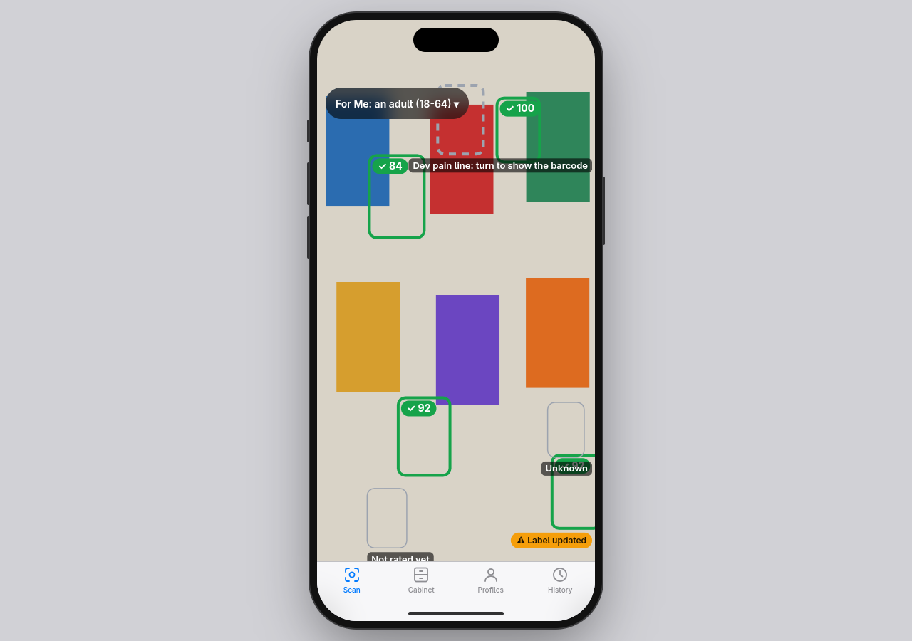
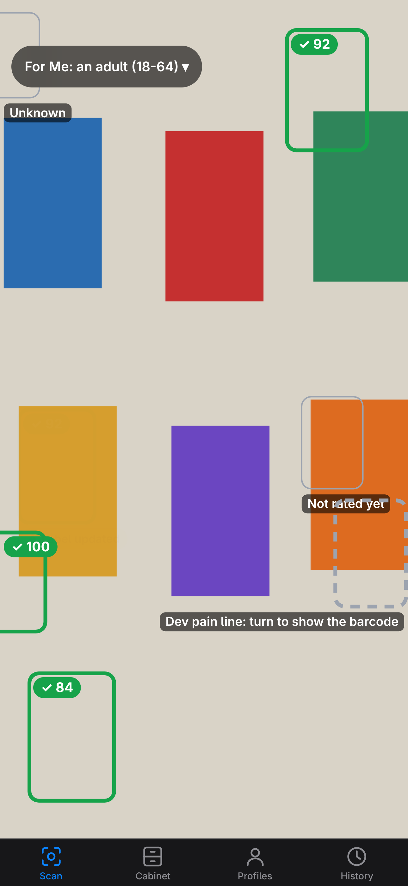
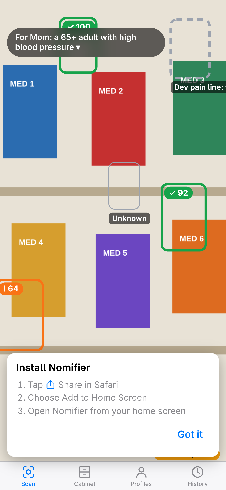
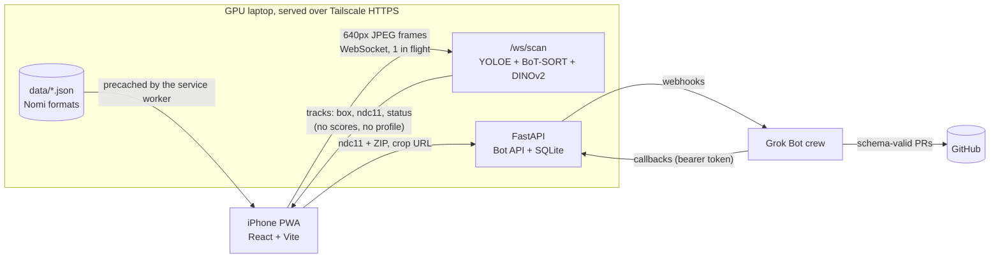

# Nomifier

Point your phone at medicine and every box and bottle lights up green, orange or red, scored for the person who will take it.



Nomifier is our entry in the BDBI x SpaceXSI Grokathon (Georgia Tech, November 2026). It builds on BDBI's [Nomi](https://github.com/gt-big-data/nomi), the over-the-counter medicine safety scanner that turns one barcode into a personalized, cited 0–100 score. Nomifier does the same for everything in view, live: a GPU laptop recognizes and tracks each product in the camera feed, the phone scores it locally with Nomi's own data formats, and a crew of Grok Bots handles what no API can.

The user's health profile never leaves the phone. The server only sees camera frames, and the Bots only see a product ID, a product photo and a ZIP code.

## On the phone

An installable PWA that looks and behaves like a native iPhone app. Add it to the home screen from Safari and it opens full screen, with a tab bar, bottom sheets and safe-area layouts.

|                                                                                                                                                                                                                      |                                                                                                                                                                                      |
| -------------------------------------------------------------------------------------------------------------------------------------------------------------------------------------------------------------------- | ------------------------------------------------------------------------------------------------------------------------------------------------------------------------------------ |
|                                                                                                                                                                                |                                                                                                                                      |
| **Live AR.** Outlines glide with each product, with a score badge and a tier icon (✓ ! ✕) so color isn't the only signal. Look-alikes stay gray and dashed until the barcode confirms them; unrated products say so. | **Profiles.** One tap switches "Me" to "Mom, 65+, high blood pressure" and everything recolors instantly, with no network call (the cold medicine drops from 84 green to 64 orange). |

_Screenshots use the mock recognition server and dev fixtures (fake products), at an iPhone viewport._

Coming next: the detail sheet with Nomi's verdict, cited risks and DailyMed source; the Medicine Cabinet with duplicate-ingredient warnings; and Find nearby (Aisle Finder).

Also on the phone:

- An arrow from a red product to a safer one in view that shares its use, and a ★ on the best match for "I need…" (pain, allergy, sleep, cough, stomach).
- Barcode lock: a readable barcode locks a track to the exact product, using Nomi's `ndcCandidates()` and a WebAssembly barcode reader (iOS Safari has no `BarcodeDetector`).
- Honest unknowns: an unrecognized product is thin gray, and tapping it sends its best crop to the Coverage Clerk. A product with an ingredient we haven't rated says "Not rated yet" and is never green.
- Compare two products side by side, risk by risk.
- Label Watch badges on products whose label changed or that were recalled.
- Read aloud, large text, and "questions to ask your pharmacist" built from templates.
- A CV HUD with fps, latency and per-track similarity, for anyone who wants to see the machinery.
- Offline: the app shell, product data, cards, cabinet and barcode scanning work with no network. Only live recognition needs the server.

## The Grok Bot crew

| Bot                | Trigger                                 | What it does                                                                                                                                                                   |
| ------------------ | --------------------------------------- | ------------------------------------------------------------------------------------------------------------------------------------------------------------------------------ |
| **Aisle Finder**   | Webhook from "Find nearby"              | Searches pharmacy pages near the ZIP for the safer product and store brands with identical active ingredients and strengths, holds a pickup order, and stops for your approval |
| **Coverage Clerk** | Webhook from tapping an unknown product | Reads the crop, finds the product on DailyMed, drafts a `product.json`, validates it with Nomi's schema package, and opens a pull request                                      |
| **Label Watch**    | Weekly schedule                         | Checks DailyMed label versions and FDA recalls, posts a Page, and opens a PR updating `data/label_status.json`. Never edits a score                                            |

All three share one skill: cite everything, never score, ask before acting.

## Architecture



- **PWA.** React 19, TypeScript and Vite with `vite-plugin-pwa`. Scoring, profiles, cabinet and history run on the phone. Every network call goes through one module, `web/src/api.ts`, which a privacy test scans.
- **Recognition server.** FastAPI on the GPU laptop. One frame in flight: frames that arrive while one is processing are dropped, never queued.
- **Tailscale.** `tailscale serve` gives the app a real HTTPS certificate (the camera needs one) on the tailnet; Tailscale Funnel opens the same URL to judges' phones and Bot callbacks.
- **Grok Bots.** Webhook and scheduled routines with taught tasks, computer use, GitHub access and approvals.

## Vision pipeline

- **YOLOE** (Ultralytics, open vocabulary) detects products from text prompts like "medicine box" and "pill bottle", so it works in a hand, on a table or on a shelf, with no training.
- **BoT-SORT** keeps an ID on each product across frames, with global motion compensation for a moving phone.
- **DINOv2** identifies each new or unstable track against a catalog of a few photos per product, with a running average per track. A product is identified once and then tracked almost for free, which is what makes it real time.
- Look-alikes whose top matches belong to one product line come back as a **family**, never a guessed product.

## Scoring

Nomifier implements Nomi's scoring function (Nomi `docs/system-design.md` §6.2) over Nomi's `term-tables` format: per risk dimension, each ingredient's points for the persona plus any matching conditions and medication types, combined across ingredients (`max_plus_stacking`), subtracted from 100. Any hard stop forces red; tiers are green ≥ 75, yellow 50–74, red below 50. Every point traces to a citation (DailyMed label section, ACB or STOPP/START). The TypeScript engine and a Python twin are checked against the same golden vectors. LLMs never produce scores.

Demo values are in Nomi's format but are not Nomi's rubric, and nothing here is medical advice.

## Privacy

- **Profiles, conditions, medications and the cabinet stay on the phone** (localStorage). Scoring runs there.
- **The recognition server** gets camera frames and returns boxes, NDC11s and track status, never a score or a profile.
- **The Bots** get an NDC11, the ingredient list, a product crop URL, a ZIP or an approval decision. Nothing else.
- **Enforced by a test.** `server/tests/test_privacy.py` fails the build if any request model or webhook payload in
  the server has a profile-shaped field, if a Nomi persona, condition or medication-type value appears as a string in
  server code, or if `web/src/api.ts` (the phone's only network module) mentions one.

## How we built it

Every task was a small branch and a pull request into `main`; the specs are in the
[implementation plan](Nomifier%20-%203-person%20implementation%20plan.md) §7–§9.

<!-- TODO(A9, 9:35): regenerate this list from the final PR state and add who/which agent built each task. -->

| Task | Branch / PR | Built by |
| --- | --- | --- |
| A1 repo scaffold, Nomi vendoring, frozen contract | [#1](https://github.com/rustybubble/nomifier/pull/1) | cloud coding agent |
| A4 Bot API, SQLite store, privacy test | [#2](https://github.com/rustybubble/nomifier/pull/2) | cloud coding agent |
| A8 shared Bot skill, routines doc | [#3](https://github.com/rustybubble/nomifier/pull/3) | cloud coding agent |
| A2 product resolver (openFDA → DailyMed → Nomi schema) | [#4](https://github.com/rustybubble/nomifier/pull/4) | cloud coding agent |
| A3 scoring twin, data validator, golden vectors | [#5](https://github.com/rustybubble/nomifier/pull/5) | cloud coding agent |
| C1–C4 iPhone PWA shell, camera + AR overlay, on-device scoring, mock server | `c1-pwa-shell` | TODO |
| A branches integrated, scoring wired into the AR overlay | `integrate-a` | TODO |

**Grok Bot receipts** (`bots/screenshots/`):

<!-- TODO(A9): add the images once A5–A7 are set up. Expected files: the webhook and schedule routines, the taught
"Aisle Finder lookup" task, an Aisle Finder run stopping for approval, the Coverage Clerk PR, the Label Watch Page. -->

## Repo layout

```
web/              iPhone-style PWA (React + Vite + TypeScript)
server/           FastAPI app: static hosting, Bot API, SQLite
vision/           recognition server, catalog, eval, bench
data/             products, term tables, templates, label status (Nomi formats)
scripts/          product resolver (openFDA + DailyMed), Python scorer, data validation
vendor/nomi/      schemas, generated types and barcode parsers from Nomi (credited)
bots/             Grok Bot skills, routines and screenshots
tools/            mock recognition server and dev fixtures
contracts/        the frozen API contract
docs/             demo script, rubric notes, media
```

## Local development

```sh
uv run tools/mock_ws.py                               # mock recognition + Bot API on :8001, serves dev fixtures
cd web && pnpm install
VITE_SERVER_URL=http://localhost:8001 pnpm dev        # the PWA on :5173
pnpm exec vitest run                                  # front-end tests
cd .. && uv sync && uv run pytest                     # server, Bot API, privacy test, product resolver, scorer twin
```

On an iPhone, run `tailscale serve --bg 5173` on the dev machine and open `https://<machine>.<tailnet>.ts.net`. Add `?frame=iphone` on a laptop to see the app inside an iPhone frame, driven by the webcam.

## Run it for the demo

On the GPU laptop:

```sh
uv sync
pnpm --dir web install && pnpm --dir web build        # served by FastAPI at /
uv run uvicorn server.main:app --host 127.0.0.1 --port 8000
tailscale serve --bg 8000                             # tailnet HTTPS
tailscale funnel --bg 8000                            # only for judges' phones and Bot callbacks
```

Secrets (`BOT_TOKEN`, webhook keys) go in `.env`; see `.env.example`.

## Tests

- Vitest for the PWA: the scoring engine against golden vectors and Nomi's own sample, the frame-streaming and tracking logic, and barcode parsing against Nomi's fixtures.
- Playwright and Chrome DevTools runs at iPhone viewports.
- pytest for the server, the Bot API, the privacy test and the mock server.

## Documentation

- [Nomifier - final writeup.md](Nomifier%20-%20final%20writeup.md): the final plan, features and demo script
- [Nomifier - 3-person implementation plan.md](Nomifier%20-%203-person%20implementation%20plan.md): the build split and task specs
- [contracts/api.md](contracts/api.md): the frozen API contract
- [tools/fixtures/README.md](tools/fixtures/README.md): dev fixtures and their expected scores

## Credits and license

Built on [Nomi](https://github.com/gt-big-data/nomi) by the BDBI Nomi team. The files in `vendor/nomi/` are copied from Nomi with the team's permission and keep Nomi's terms; Nomi's repository has no license, so they are not relicensed here. A license for the rest of Nomifier is still to be chosen.
